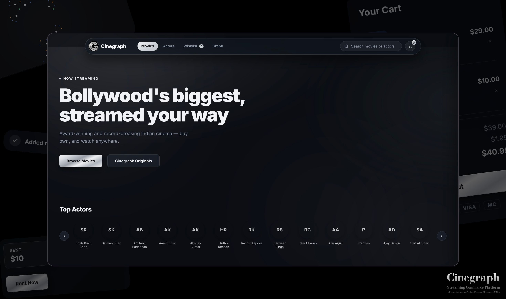
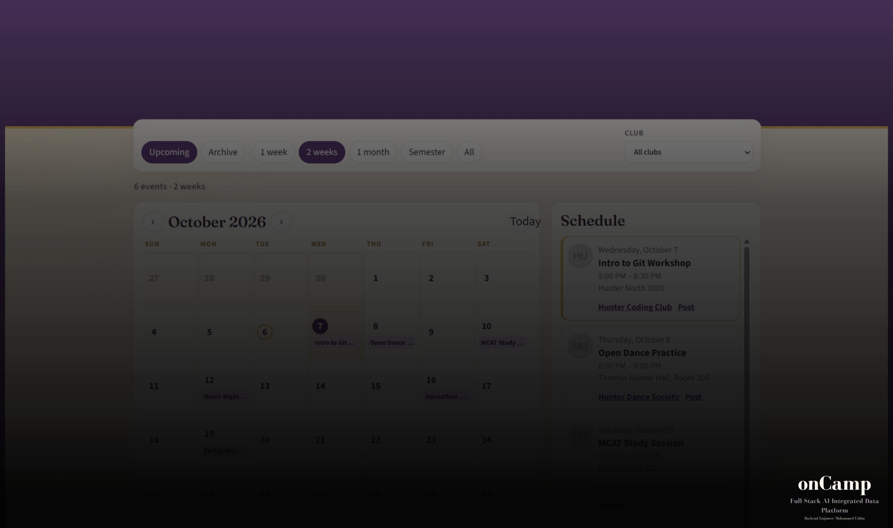

  <h1>Full-Stack Development</h1>

---

## [**LIVE SITE: Cinegraph (Streaming Commerce Platform)** – Full-Stack Development · Data Visualization · Product Design](#)

**Cinegraph** combines product design with full-stack engineering, connecting an iterated **typography, color, motion, responsive, and accessibility system** to a **Node.js/Express application layer, parallel REST and GraphQL APIs, normalized SQLite data model, transactional checkout, persistent UUID-based session state, and server-side TMDb proxy/integration layer** for credential isolation, external-data normalization, and database upserts.

  

[View  examples of **Product & Visual Design**.](https://github.com/cryp-moh-graphy/ui-ux-product-visual-design)

---

## [**LIVE SITE: (Intelligent Data Aggregation & Discovery Platform)** – Full-Stack Development](#)

[View Mohammed Uddin's **Commits**](https://github.com/Sudiptto/onCamp/commits?author=mcodes450)
[View Mohammed Uddin's **Pull Requests**](https://github.com/Sudiptto/onCamp/pulls?q=is:pr+author:mcodes450)

  

[View  examples of **Product & Visual Design**.](https://github.com/cryp-moh-graphy/ui-ux-product-visual-design)

---
