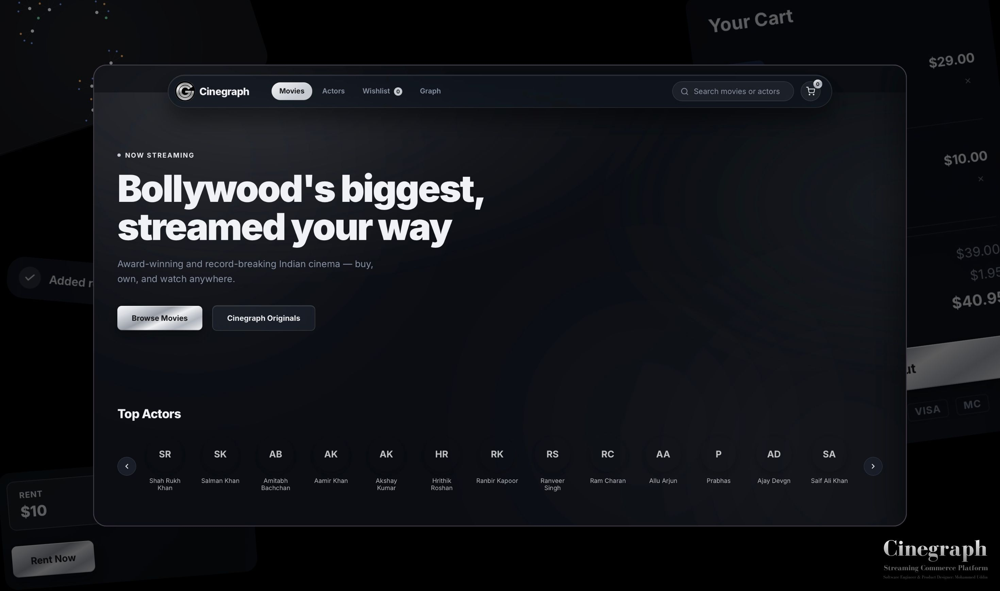
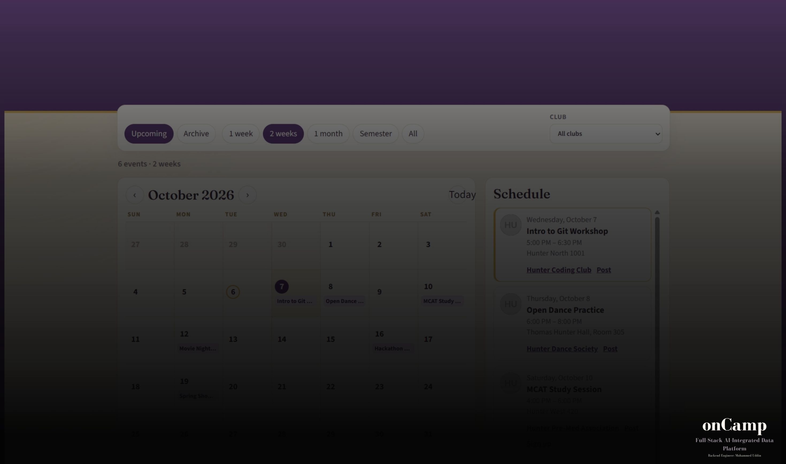

  <h1>Full-Stack Development</h1>

---

## [**LIVE SITE: Cinegraph (Streaming Commerce Platform)** – Full-Stack Development · Data Visualization · Product Design](#)

**Cinegraph** combines product design with full-stack engineering, connecting an iterated **typography, color, motion, responsive, and accessibility system** to a **Node.js/Express application layer, parallel REST and GraphQL APIs, normalized SQLite data model, transactional checkout, persistent UUID-based session state, and server-side TMDb proxy/integration layer** for credential isolation, external-data normalization, and database upserts.

  

[View  examples of **Product & Visual Design**.](https://github.com/cryp-moh-graphy/ui-ux-product-visual-design)

---

## [**LIVE SITE: (Intelligent Data Aggregation & Discovery Platform)** – Full-Stack Development](#)

[View Mohammed Uddin's **Commits**](https://github.com/Sudiptto/onCamp/commits?author=mohammed-builds256)
 
[View Mohammed Uddin's **Pull Requests**](https://github.com/Sudiptto/onCamp/pulls?q=is:pr+author:mohammed-builds256)

  

> **All backend architecture, pipeline optimizations, and project roadmaps below were authored and shipped by Mohammed Uddin under the collaboration account [@mohammed-builds256](https://github.com/mohammed-builds256).**

- **[Commit `46ebf6a`](https://github.com/Sudiptto/onCamp/commit/46ebf6a):** Designed core SQLAlchemy relational models (`College`, `Club`, `ClubActivity`) and engineered an atomic, CLI-driven ETL synchronization script (`backend/sync_clubs.py`) with strict input sanitization and defensive record validation.
- **[PR #3](https://github.com/Sudiptto/onCamp/pull/3) & [PR #5](https://github.com/Sudiptto/onCamp/pull/5):** Normalized database schemas to persist immutable numeric `instagram_user_id` identifiers, eliminated multi-table join overhead via direct foreign-key relationships, and isolated local development database artifacts from Git.
- **[PR #6](https://github.com/Sudiptto/onCamp/pull/6):** Built the automated due-club background scheduler (`run_due_activity_checks.py`), first-time deployment college seeding (`seed_colleges.py`), and a 30-day error backoff system (`sync_club_activity.py`) to prevent API rate-limit throttling.
- **[Issue #7](https://github.com/Sudiptto/onCamp/issues/7):** Proposed DeepSeek club filter reliability and cost optimization.
- **[PR #8](https://github.com/Sudiptto/onCamp/pull/8):** Engineered 22-file backend hardening update including exponential backoff API retries, atomic prompt caching, per-IP rate limiting, and 81 passing unit tests *(Closes #7)*.
- **[Issue #9](https://github.com/Sudiptto/onCamp/issues/9):** Formulated project execution, 5-phase timeline, and go-to-market strategy.
- **[Issue #12](https://github.com/Sudiptto/onCamp/issues/12):** Authored 3-phase authentication, email policy, server-side authorization blueprint, and pre-deployment launch promotion & QR referral attribution plan.
- **[PR #14](https://github.com/Sudiptto/onCamp/pull/14):** Implemented full-stack passwordless Google OAuth sign-in (`verify_oauth2_token`), `HttpOnly`/`SameSite` session cookies, constant-time CSRF validation, and server-side access boundaries (`ANON_EVENT_DAYS = 7`) across 24 files.
- **[PR #17](https://github.com/Sudiptto/onCamp/pull/17):** Shipped one-click Google Calendar deep links and RFC 5545-compliant `.ics` file exports (`calendar.js`) with `CRLF` line endings, text escaping, 75-octet line folding, and 8 Node unit tests.
- **[PR #19](https://github.com/Sudiptto/onCamp/pull/19):** Built privacy-preserving `GET /api/stats` endpoint and header stats chips featuring 10-minute in-memory TTL caching, test-account exclusion, 100-user privacy rounding floor, database-outage fallback, and 12 pytest tests.

[View  examples of **Product & Visual Design**.](https://github.com/cryp-moh-graphy/ui-ux-product-visual-design)

---
